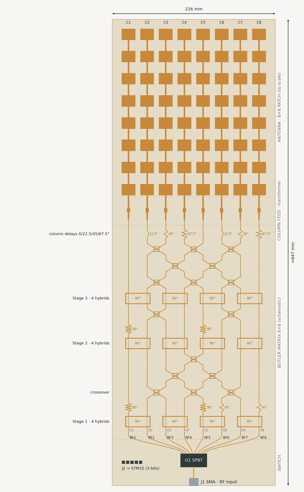
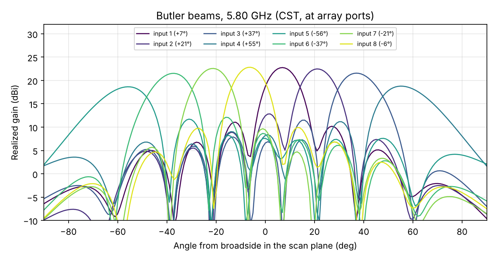
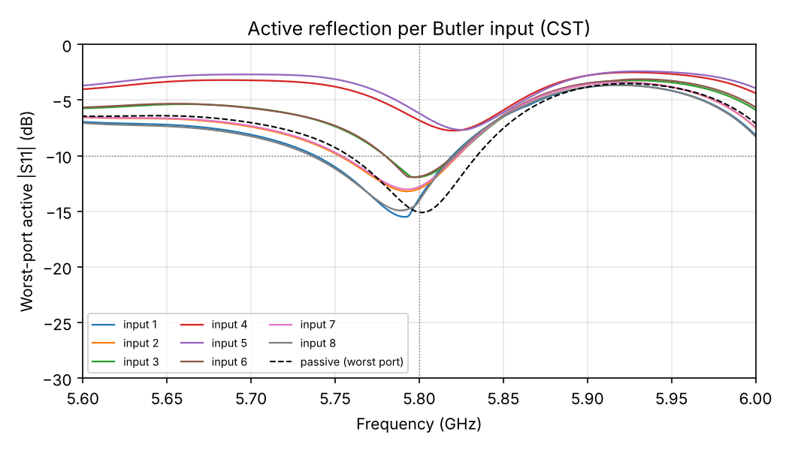
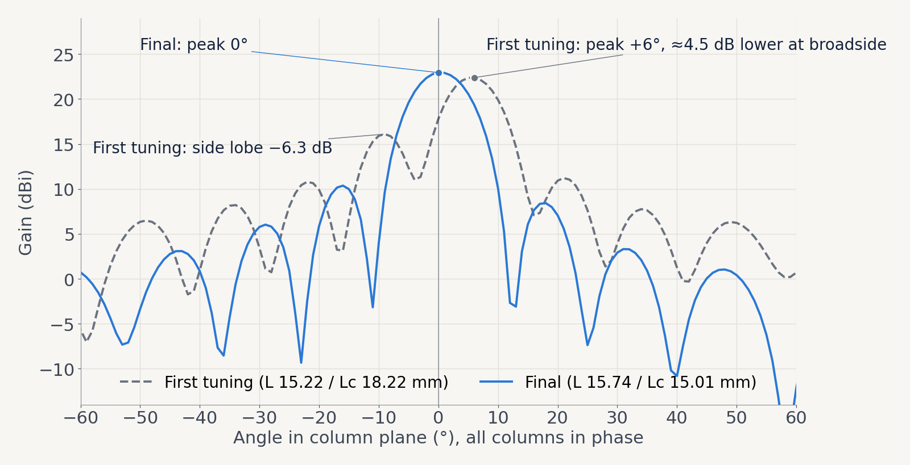

# 5.8 GHz 8×8 Patch Array with Butler-Matrix Beam Switching

A 64-patch array for a UAV video-link ground station. An 8×8 Butler matrix steers the beam to 8 fixed directions in azimuth with no mechanical rotation. Full-wave simulated in commercial CST Studio Suite.

*Türkçe açıklama: [README.tr.md](README.tr.md)*

**Signal chain:** STM32 (3 GPIO) → SP8T switch → 8×8 Butler matrix → 8 series-fed columns → 64 patches



## Results (CST, 5.80 GHz)

| Quantity | Value |
|---|---|
| Beams | 8; ±6–7°, ±21°, ±37°, ±55–56° |
| Realized gain | 22.8 dBi (inner beams) … 18.6 dBi (±55°) |
| 3 dB beamwidth | 12–20° in the scan plane, 10° in the column plane |
| Side-lobe level | −6.9 … −12.9 dB (scan plane), −12.9 dB (column) |
| Passive S11 | −15 dB; −10 dB band 5.757–5.834 GHz |
| Active S11, worst port | inner 6 beams −11.9 … −14.1 dB; ±55° beams −6.2 … −6.8 dB |
| Column beam tilt | ≤ 0.4° |

Gains are at the array ports; Butler-matrix and SP8T losses are not included.

| Butler input | Direction | Realized gain | HPBW | SLL | Worst active S11 |
|---|---|---|---|---|---|
| 1 | +7° | 22.8 dBi | 12.3° | −11.7 dB | −13.9 dB |
| 2 | +21° | 22.5 dBi | 13.0° | −9.6 dB | −13.0 dB |
| 3 | +37° | 21.6 dBi | 15.5° | −10.1 dB | −11.9 dB |
| 4 | +55° | 18.8 dBi | 20.0° | −7.6 dB | −6.8 dB |
| 5 | −56° | 18.6 dBi | 20.0° | −6.9 dB | −6.2 dB |
| 6 | −37° | 21.5 dBi | 15.5° | −9.4 dB | −11.9 dB |
| 7 | −21° | 22.6 dBi | 13.5° | −12.9 dB | −12.8 dB |
| 8 | −6° | 22.8 dBi | 12.4° | −12.9 dB | −14.1 dB |







## Design

| Parameter | Value |
|---|---|
| Substrate | JLCPCB ZYF265D, εr 2.65, tanδ 0.0019, 0.762 mm |
| Patch | W 19.1 mm, L 15.74 mm |
| Column spacing d | 25.9 mm (λ₀/2) |
| Patch pitch p / connecting line Lc | 30.75 mm / 15.01 mm |
| Input transformer | 4.40 × 6.00 mm, d1 = 17.80 mm from the patch |
| Butler matrix | 3 stages × 4 hybrids, 16 crossovers (two hybrids each), input order 1,5,3,7,2,6,4,8 |
| Board | ~22.6 × 65 cm (antenna 22.6 × 27.8 cm) |

## Process

1. Pre-design in openEMS (CST Learning Edition was limited to 100 000 mesh cells).
2. Move to commercial CST with a mesh-convergence test; openEMS's coarse mesh had pulled the resonance down by ~110 MHz.
3. In the first CST tuning S11 was centred at 5.80 GHz, but the column beam was tilted 5.5° (cell phase exceeded 360° by 22°), costing 4.5 dB of broadside gain.
4. L and Lc were tuned together using measured sensitivities and the matching transformer was redesigned with an ideal-line model. Tilt dropped to 0.1° and broadside gain rose from 17.7 to 22.8 dBi.
5. In total: 5 full-array runs and 14 single-column runs.

Details: [dokumanlar/teknik_ozet.md](dokumanlar/teknik_ozet.md)

## Reproducing the analysis

The Butler matrix is not simulated as one circuit. The hybrid and the crossover were simulated separately in CST (`s-parametreleri/hibrit_762.s4p`, `crossover_762.s4p`). `scriptler/butler_hesap.py` cascades them into the column excitations `s-parametreleri/butler_agirliklar_762.txt`, which are then applied to the full-wave array results:

```
pip install numpy matplotlib
python scriptler/butler_hesap.py                      # hybrid + crossover -> Butler weights
python scriptler/aktif_s11.py                         # s8p + weights -> active S11
python scriptler/butler_huzmeler.py <farfield folder> # 8 port farfields -> beams, gain, table
python scriptler/sutun_desen.py <farfield folder>     # single column pattern
```

The per-port farfields (8 × 10 MB at 5.80 GHz) are too large for this repository. Regenerate them by running `cst-makrolar/cst_farfield_aktar.bas` in `cst/dizi8x8cst.cst`.

## Limitations

- Simulation only; not fabricated (the board is too large for low-cost PTFE prototyping).
- The Butler matrix is evaluated by network calculation from separately simulated hybrids and crossovers, not as one full-wave circuit.
- Butler and SP8T insertion loss are not included in the gain figures.
- The ±55° beams have poor active match (−6.2 … −6.8 dB), which is typical for wide-angle scanning with λ/2 spacing.

## Files

| Path | Contents |
|---|---|
| `cst/` | `dizi8x8cst.cst` (final 8×8 array), `sutun_cst_762.cst` (single column), series-column trials, `kuplaj.cst`, `patch.cst` |
| `cst/butler/` | crossover designs (3-branch → final two-hybrid) |
| `cst-makrolar/` | VBA macros that build the array and export S-parameters and farfields |
| `scriptler/` | Butler weights, active S11, beam analysis, openEMS pre-design |
| `s-parametreleri/` | `dizi_cst_762.s8p` (final array), `hibrit_762.s4p` and `crossover_762.s4p` (final hybrid and crossover), Butler weights; the `.zip` files hold earlier iterations and the single-column `.s8p` |
| `sonuclar/cst/` | final CST analysis: beam table, active S11, plots |
| `sonuclar/openems/` | openEMS pre-design results |
| `sunum/` | presentation figures (TR and EN) |
| `dokumanlar/` | technical summary, CST guides, literature review |

## Author

Selim Süleyman Hüthüt, Electrical and Electronics Engineering, Çukurova University

## License

MIT, see [LICENSE](LICENSE).
