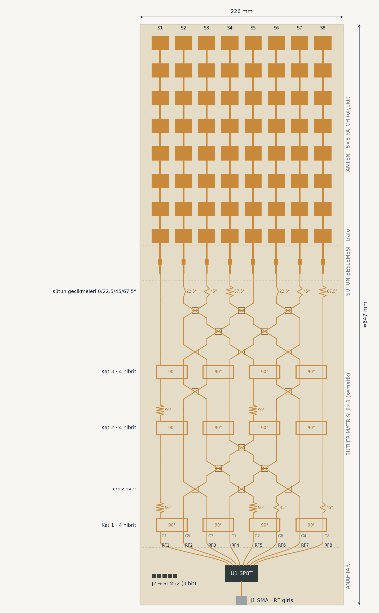

# 5.8 GHz 8×8 Butler Matrisli Anahtarlamalı Hüzme Dizisi

*English: [README.md](README.md)*

İHA video linki yer istasyonu için, mekanik döndürme gerektirmeden yatayda 8 yöne çevrilebilen 64 patch'li anten dizisi. Tamamı ticari CST Studio Suite'te tam dalga simüle edildi.

**Zincir:** STM32 (3 GPIO) → SP8T anahtar → 8×8 Butler matrisi → 8 seri beslemeli sütun → 64 patch

## Final sonuçlar (CST, 5.80 GHz)

| Büyüklük | Değer |
|---|---|
| Hüzmeler | 8; ±6–7°, ±21°, ±37°, ±55–56° |
| Yatay kazanç | 22.8 dBi (iç) … 18.6 dBi (±55°) |
| 3 dB hüzme genişliği | 12–20° (tarama), 10° (sütun) |
| Yan lob | −6.9 … −12.9 dB (tarama), −12.5 / −14.5 dB (sütun) |
| Pasif S11 | −15 dB; −10 dB bandı 5.757–5.834 GHz |
| Aktif S11 (en kötü port) | iç 6 hüzme −11.9 … −14.0 dB; ±55° −6.2 … −6.8 dB |
| Kuplaj / verim | −19 dB / ~%71 |
| Sütun hüzme eğimi | ≤ 0.4° |

Kazançlar dizi portlarında; Butler ve SP8T kaybı dahil değil.

## Tasarım

| Parametre | Değer |
|---|---|
| Alttaş | JLCPCB ZYF265D, εr 2.65, tanδ 0.0019, 0.762 mm |
| Patch | W 19.1 mm, L 15.74 mm |
| Sütun aralığı d | 25.9 mm (λ₀/2) |
| Sütun içi aralık p / bağlantı hattı Lc | 30.75 mm / 15.01 mm |
| Giriş trafosu | 4.40 × 6.00 mm, patch'ten d1 = 17.80 mm |
| Butler | 3 kat × 4 hibrit, 16 crossover (her biri 2 hibrit), giriş sırası 1,5,3,7,2,6,4,8 |
| Kart | ~22.6 × 65 cm (anten 22.6 × 27.8 cm) |

## Süreç

1. openEMS'te ön tasarım (CST Learning Edition 100 bin hücre sınırı yüzünden).
2. Ticari CST'ye geçiş: mesh yakınsama testi; openEMS'in kaba mesh'i rezonansı ~110 MHz aşağı çekiyordu.
3. İlk CST ayarında S11 tam 5.80'deydi ama sütun hüzmesi 5.5° eğikti (hücre fazı 360°'yi 22° aşıyordu), yatayda 4.5 dB kayıp.
4. L ve Lc ölçülen duyarlılıklarla birlikte ayarlandı, eşleşme trafosu ideal hat modeliyle yeniden tasarlandı: eğim 0.1°, yatay kazanç 17.7 → 22.8 dBi.
5. Toplam 5 tam dizi ve 14 tek sütun koşusu.

Ayrıntılar: [dokumanlar/teknik_ozet.md](dokumanlar/teknik_ozet.md)

## Dosyalar

| Klasör | İçerik |
|---|---|
| `cst/` | `dizi8x8cst.cst` (final 8×8 dizi), `sutun_cst_762.cst` (tek sütun), seri sütun denemeleri, `kuplaj.cst`, `patch.cst` |
| `cst/butler/` | crossover tasarımları (3 kollu → 2 hibritli final) |
| `cst-makrolar/` | diziyi kuran ve S/uzak alan dışa aktaran VBA makroları |
| `scriptler/` | `butler_hesap.py` (hibrit_762 + crossover_762 → Butler ağırlıkları), `aktif_s11.py`, `butler_huzmeler.py`, `sutun_desen.py` (final CST analizi), `dizi8x8_openems.py` |
| `s-parametreleri/` | `dizi_cst_762.s8p` (final dizi), hibrit ve crossover `.s4p` (her biri zip içinde), Butler ağırlıkları |
| `sonuclar/cst/` | final CST analizi: hüzme tablosu, aktif S11, grafikler |
| `sonuclar/openems/` | openEMS ön tasarım sonuçları (grafikler ve hüzme tablosu) |
| `sunum/` | sunum görselleri (TR ve EN) |
| `dokumanlar/` | teknik özet, CST rehberleri, literatür taraması |
