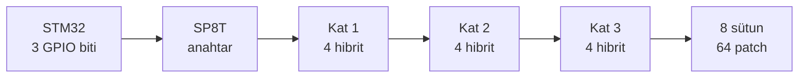

# 5.8 GHz 8×8 Butler Dizisi – Teknik Özet

Oct 10, 2026 · @selim

## Proje özeti ve son durum

5.8 GHz'de çalışan 64 patch'li (8×8) bir anten dizisi tasarlandı. Hüzme, 8×8 Butler matrisi, SP8T RF anahtar ve STM32 ile yatay düzlemde 8 sabit yöne çevriliyor. Final tasarım JLCPCB'nin ZYF265D (0.762 mm) laminatına göre yapıldı ve 64 elemanın tamamı ticari CST Studio Suite'te tam dalga simüle edildi: en iyi hüzmede yatay kazanç 22.8 dBi, sütun hüzmesi tam dik.

Sistem zinciri: **STM32 (3 GPIO biti) → SP8T anahtar → 8×8 Butler matrisi → 8 seri beslemeli sütun → 64 patch.**

| Büyüklük | Değer |
| --- | --- |
| Frekans | 5.80 GHz (ISM bandı 5.725–5.875 GHz), λ₀ = 51.7 mm |
| Alttaş | ZYF265D (JLCPCB), εr = 2.65 ± 0.04, tanδ = 0.0019, h = 0.762 mm, 35 µm bakır |
| Dizi | 8 × 8 patch (19.1 × 15.74 mm), sütun aralığı 25.9 mm (λ₀/2), sütun içi aralık 30.75 mm (0.59 λ₀) |
| Hüzmeler | 8 hüzme: +7°, −6°, ±21°, ±37°, +55° / −56° (yatay düzlem); sütun yönünde dik (eğim ≤ 0.4°) |
| Kazanç (yatay düzlem, Butler kaybı hariç) | 22.8 dBi (iç hüzmeler) … 18.6 dBi (±55°) |
| 3 dB hüzme genişliği | 13° (dike yakın) … 21° (±55°); sütun yönünde 11° |
| Yan lob seviyesi | tarama düzleminde −6.9 … −12.9 dB; sütun düzleminde −12.5 / −14.5 dB |
| Pasif S11 (her port) | 5.80 GHz'de −15 dB; −10 dB bandı 5.757–5.834 GHz |
| 5.80 GHz'de en kötü aktif S11 | iç 6 hüzme −11.9 … −14.0 dB; ±55° hüzmeler −6.2 … −6.8 dB (ortalama yansıma kaybı 0.65 dB) |
| İç 6 hüzmenin çalıştığı bant | ≈ 5.78–5.82 GHz (\~40 MHz) |
| Kullanılan araçlar | CST Studio Suite 2025 (zaman domeni, 30 hücre/λ, 8.8 milyon hücre), openEMS 0.37 (ön tasarım), Python (Butler ve uzak alan birleştirme) |

Açık kalan konu: hüzme dikey düzlemde (y ekseni) yönlendirilemiyor. Sebebi ve olası çözümler 11. bölümde.

## 1. Alttaş seçimi: neden ZYF265D (0.762 mm)

Final alttaş JLCPCB'nin ZYF265D PTFE laminatı: εr = 2.65, tanδ = 0.0019, h = 0.762 mm. İlk tasarım F4BM265 (0.8 mm) içindi; basılabilir bir karta uyması için JLCPCB'nin standart kalınlığına geçildi.

| Malzeme | εr (tolerans) | tanδ | εr toleransının kaydırdığı rezonans | Not |
| --- | --- | --- | --- | --- |
| FR4 | \~4.3–4.6 | \~0.02 | yüzlerce MHz | 50 Ω hatta \~1.75 dB/100 mm kayıp; Butler yolu için uygun değil |
| **ZYF265D (seçilen)** | 2.65 ± 0.04 | 0.0019 | ±44 MHz | \~0.13 dB/100 mm; JLCPCB'de 0.76 / 1.52 mm, en fazla 590 × 438 mm |
| F4BM265 (ilk tasarım) | 2.65 | 0.001 | – | 0.8 mm |
| Rogers RT/duroid 5880, TLY-5 | 2.2 ± 0.02 | 0.0009 | ±26 MHz | en iyi tolerans, en pahalı |

- **Kalınlık değişimi:** 0.8 → 0.762 mm'de hat genişlikleri 0.9525 ile ölçeklendi (50 Ω: 2.20 → 2.10 mm). εeff neredeyse aynı kaldığı için boylar değişmedi.
- **Kayıp neden önemli:** Butler matrisinde sinyal 3 hibrit, birkaç crossover ve uzun gecikme hatlarından geçiyor. FR4 ile bu yol dB'lerce kayıp ekler; PTFE ile küçük kalır.
- **Tolerans:** Tüm hüzmelerin çalıştığı bant \~40 MHz, εr toleransının kaydırması ±44 MHz (Δf/f ≈ Δεr / 2εr). Üretim yapılırsa önce tek sütunluk test kartı gerekir.

## 2. Tek patch tasarımı

Patch boyutları transmisyon hattı modeli formülleriyle hesaplandı, sonra CST'de seri sütunla birlikte ayarlandı: **W = 19.1 mm, L = 15.74 mm.**

Genişlik (verimli ışıma için):

```latex
W = \frac{c}{2 f_0}\sqrt{\frac{2}{\varepsilon_r + 1}} = \frac{3\times10^8}{2 \cdot 5.8\times10^9}\sqrt{\frac{2}{3.65}} \approx 19.1\ \text{mm}
```

Etkin dielektrik sabiti (alanın bir kısmı havada olduğu için εr'den küçük):

```latex
\varepsilon_{eff} = \frac{\varepsilon_r + 1}{2} + \frac{\varepsilon_r - 1}{2}\left(1 + 12\frac{h}{W}\right)^{-1/2} \approx 2.50
```

Saçak alan uzaması ve rezonans boyu:

```latex
\Delta L = 0.412\,h\,\frac{(\varepsilon_{eff}+0.3)(W/h+0.264)}{(\varepsilon_{eff}-0.258)(W/h+0.8)} \approx 0.40\ \text{mm}
```

```latex
L = \frac{c}{2 f_0 \sqrt{\varepsilon_{eff}}} - 2\Delta L \approx 16.36 - 0.81 \approx 15.5\ \text{mm}
```

- Formül yaklaşık 15.5 mm veriyor. Final L = 15.74 mm; sütunun eşleşmesi ve hüzme yönüyle birlikte ayarlandı (5. bölüm).
- Işıyan kenarlar L'nin iki ucu. Akım L boyunca (sütun yönünde) akar, polarizasyon lineer ve sütun doğrultusunda.
- 50 Ω hat genişliği 2.10 mm (εeff ≈ 2.19, λg ≈ 34.9 mm).

## 3. Dizi geometrisi: eleman aralığı

Sütunlar arası mesafe **d = 25.9 mm = λ₀/2** seçildi. Böylece hüzme hangi açıya dönerse dönsün ikinci bir ana hüzme (grating lob) oluşmaz.

Grating lob oluşmaması için koşul (θ₀ = tarama açısı):

```latex
\frac{d}{\lambda_0} < \frac{1}{1 + |\sin\theta_0|}
```

- d = λ₀/2 için bu koşul 90°'ye kadar her açıda sağlanır.
- Aralık daha küçük olsaydı kuplaj artardı; patch zaten 19.1 mm geniş, aradaki boşluk sadece 6.8 mm.
- Aralık daha büyük olsaydı kazanç biraz artardı ama ±56°'lik hüzmelerde grating lob görünürdü.

Sütun içindeki aralık ise **p = L + Lc = 15.74 + 15.01 = 30.75 mm ≈ 0.59 λ₀**. Bu yönde tarama yapılmadığı için (sütun sabit hüzmeli) λ/2'den büyük olması sorun değil. Ama dikey tarama istenirse bu aralık yetişmez (11. bölüm).

Antenin fiziksel açıklığından beklenen en yüksek yönlendiricilik:

```latex
D_{max} \approx \frac{4\pi A}{\lambda_0^2} = \frac{4\pi\,(8 \cdot 25.9)(8 \cdot 30.75)\ \text{mm}^2}{(51.7\ \text{mm})^2} \approx 240 \;\Rightarrow\; 23.8\ \text{dBi}
```

Simülasyondaki 22.8 dBi kazanç bu sınırın 1 dB altında. Fark seri hatlardaki kayıptan ve Butler'ın sütunlara tam eşit genlik verememesinden geliyor.

## 4. Sütun besleme: neden seri besleme

Her sütunun 8 patch'i tek bir hat üzerinden seri besleniyor. Sebep yer: paralel (kurumsal) besleme ağacı 25.9 mm'lik sütun genişliğine sığmıyor.

- **Paralel besleme:** 1'den 8'e bölünen T-ekler ve λ/4 trafolar. 8 eleman için yaklaşık 42 mm genişlik istiyor, 25.9 mm'lik hücreye sığmaz.
- **Seri besleme:** Patch'ler tek bir hatla uç uca bağlanır. Genişlik sadece patch kadar (19.1 mm).

Seri beslemenin çalışma prensibi faz toplamına dayanıyor. Bir patch'ten geçerken dalga \~180°, bağlantı hattında (Lc) \~180° döner. Toplam 360° olunca bütün patch'ler aynı fazda ışır ve hüzme karta dik çıkar:

```latex
\phi_{hücre} = \phi_{patch} + \beta\,L_c \approx 180^\circ + 180^\circ = 360^\circ, \qquad \beta = \frac{2\pi\sqrt{\varepsilon_{eff}}}{\lambda_0}
```

**Bu seçimin bedeli:** Her sütunun tek girişi var ve patch'ler arasındaki faz hat uzunluğuyla sabitlenmiş. Bu yüzden dikey düzlemde hüzme yönlendirilemiyor. Ayrıca faz hat boyuna bağlı olduğu için yapı frekansa duyarlı, bant dar.

## 5. Seri sütunun ayarı: mesh, hüzme eğimi ve eşleşme

Final değerler: **L = 15.74 mm, Lc = 15.01 mm; trafo patch'ten d1 = 17.80 mm uzakta, wt = 4.40 mm, lt = 6.00 mm.** Tek sütun (CST, 30 hücre/λ): 5.80 GHz'de S11 = −15.5 dB, −10 dB bandı 5.755–5.834 GHz, kazanç 15.1 dBi, hüzme eğimi +0.1°, sütun yan lobu −12.9 / −14.3 dB.

**Mesh: openEMS neden kaymıştı.** Aynı sütun CST'de iki mesh ile çözüldü. Mesh inceldikçe rezonans yükseliyor; openEMS'in 0.88 mm'lik kaba hücreleri bu etkiyi büyütüp rezonansı \~110 MHz aşağıda gösterdi. Tek sütun ile 8×8 içindeki sütun aynı mesh'te aynı frekansı verdi, bu yüzden ayar tek sütunda (20–30 dakikalık koşularla) yapıldı. Referans mesh 30 hücre/λ.

| Çözücü, mesh (L 15.04 / Lc 18.0 mm) | Hücre sayısı | S11 minimumu |
| --- | --- | --- |
| openEMS, λ/30 (0.88 mm) | – | 5.755 GHz |
| CST, 20 hücre/λ, tek sütun | 0.85 M | 5.848 GHz |
| CST, 20 hücre/λ, 8×8 dizi | 4.07 M | 5.849 GHz |
| CST, 30 hücre/λ, tek sütun | 1.95 M | 5.868 GHz |

**Hüzme eğimi.** Rezonansı 5.80'e çekmek için L ve Lc birlikte %1.2 uzatılınca (15.22 / 18.22 mm) S11 tam oturdu. Ama 8×8'in uzak alanı, sütun hüzmesinin 5.80 GHz'de 5.5° eğik olduğunu gösterdi; yatay doğrultudaki kazanç tepeden 4.5 dB düşüktü. Sebep, hücre fazının 360°'yi \~22° aşması:

```latex
\phi_{hücre} - 360^\circ = 360^\circ\,\frac{p}{\lambda_0}\,\sin\theta_y = 360^\circ \cdot 0.647 \cdot \sin 5.5^\circ \approx 22^\circ
```

L rezonansı, Lc hücre fazını belirliyor ama ikisi de ikisini etkiliyor. Ölçülen duyarlılıklarla (Lc: −50 MHz/mm ve 8.7°/mm; L: −310 MHz/mm) iki denklem birlikte çözüldü:

| Koşu | L / Lc (mm) | 5.80 GHz'de S11 | Eğim @ 5.80 | Sütun yan lobu | Sonuç |
| --- | --- | --- | --- | --- | --- |
| 0 | 15.22 / 18.22 | −21 dB | +5.5° | −6.3 dB | yatay kazanç 4.5 dB kayıp |
| 1 | 15.22 / 16.05 | −4.6 dB | +0.9° | −9.4 dB | eğim düzeldi, rezonans 5.95 GHz'e kaçtı |
| 2 | 15.74 / 15.01 | −3.1 dB | 0.0° | −12.2 dB | ışıma doğru, eşleşme bozuk |
| 3 | 15.74 / 15.01 + yeni trafo | −15.5 dB | +0.1° | −12.9 dB | final |

**Eşleşme.** Uzunluklar değişince ilk patch kenarındaki empedans 5.80 GHz'de ≈ 17.7 Ω'a düştü. Bu değer, CST'nin S11'inden besleme hatları ideal hat modeliyle çıkarılarak bulundu. d1, wt ve lt, 5.765–5.835 GHz'de en kötü yansımayı en aza indirecek şekilde optimize edildi:

```latex
Z_t \approx \sqrt{Z_0\,R} = \sqrt{50 \cdot 17.7} \approx 30\ \Omega \;\rightarrow\; \text{optimum: } 29\ \Omega,\ w_t = 4.40\ \text{mm},\ l_t = 6.00\ \text{mm},\ d_1 = 17.80\ \text{mm}
```

Hesap −15.9 dB ve 5.757–5.840 GHz öngördü; CST −15.5 dB ve 5.755–5.834 GHz verdi. Bedel: pasif bant 102 MHz'den 79 MHz'e indi. Karşılığında yatay kazanç 4.5 dB arttı ve sütun yan lobu \~6 dB iyileşti.

## 6. 90° branch-line hibrit

Butler matrisinin temel yapı taşı 4 portlu 90° hibrit. Bir porttan giren gücü iki çıkışa eşit böler (−3 dB) ve çıkışlar arasında 90° faz farkı oluşturur. Dördüncü port yalıtımlıdır.

| Kol | Empedans | Genişlik (0.762 mm) | Boy (λg/4) |
| --- | --- | --- | --- |
| Seri kollar | Z₀/√2 = 35.4 Ω | 3.44 mm | 9.643 mm |
| Paralel kollar | Z₀ = 50 Ω | 2.10 mm | 9.811 mm |

```latex
S = \frac{-1}{\sqrt{2}}\begin{pmatrix} 0 & j & 1 & 0 \\ j & 0 & 0 & 1 \\ 1 & 0 & 0 & j \\ 0 & 1 & j & 0 \end{pmatrix}
```

- Geniş hatta εeff daha yüksek olduğu için 35 Ω kolun çeyrek dalga boyu 50 Ω kola göre biraz kısa.
- CST'de kol boyları parametrik taramayla ayarlandı. Çıkış S parametreleri `hibrit.s4p` dosyasına alındı ve Butler hesabında doğrudan kullanıldı.
- Hibrit yaklaşık %10 bant genişliğine sahip. Sistemin dar bandı hibritten değil, antenden geliyor.

## 7. Crossover: neden iki hibritli

Butler'da hatlar birbirini kesmek zorunda. Tek katmanlı kartta bunu, sinyali çapraz porta 0 dB ile aktaran bir **crossover** yapıyor. Son tasarım iki 90° hibritin arka arkaya bağlanması: düz porta sızıntı **−25.0 dB (0.762 mm; 0.8 mm'de −26.6 dB)**.

**İlk deneme: 3 kollu crossover.** 18 noktalı parametre taraması yapıldı, sızıntı hiçbir kombinasyonda −25 dB'nin altına inmedi. Bu yüzden bırakıldı.

**Neden −25 dB şart:** Butler'ın tamamı için bir ağ modeli kuruldu ve crossover sızıntısının hüzmelere etkisi hesaplandı:

| Crossover sızıntısı | Sütun faz hatası | Sonuç |
| --- | --- | --- |
| −15 dB | ±40…220° | hüzmeler dağılıyor |
| −25 dB ve altı | birkaç derece | hüzmeler doğru yerde |

Sızıntı küçük görünse de sinyal pek çok crossover'dan geçiyor ve her birinde yanlış yola sapan pay birikerek fazı bozuyor.

**İki hibritli crossover nasıl çalışır:** İlk hibrit sinyali iki yola böler (90° farkla), ikinci hibrit bu iki yolu tekrar birleştirir. Fazlar öyle toplanır ki güç tamamen çapraz porta gider, düz portta söner. Hibritler arası mesafe dx = a + w50 + 2·Lf ≈ 31.84 mm.

## 8. Butler matrisi

8×8 Butler matrisi pasif bir ağ: 8 girişten hangisine sinyal verilirse, 8 sütuna **eşit genlikte (−9.03 dB)** ve **sabit bir faz adımıyla** dağıtır. Matematiksel olarak analog bir FFT'dir: her giriş bir uzamsal frekansa, yani bir hüzme yönüne karşılık gelir.



Katlar arasında sabit gecikme hatları ve crossover'lar var (çizimde gösterilmedi).

| Parça | Sayı |
| --- | --- |
| Ana hibrit (3 kat × 4) | 12 |
| Crossover (en az sayılı düzlemsel yerleşim) | 16 (her biri 2 hibrit → 32 hibrit) |
| Toplam hibrit | 44 |
| Sabit gecikme hatları | kat 1–2: 90/45°, kat 2–3: 90°, sütun çıkışı: 0/22.5/45/67.5° |

**Faz adımları ve hüzme açıları.** Giriş m için sütunlar arası faz farkı ±22.5°, ±67.5°, ±112.5° veya ±157.5°. Hüzme açısı:

```latex
\sin\theta_m = \frac{\Delta\phi_m\,\lambda_0}{2\pi d} = \frac{\Delta\phi_m}{180^\circ} \quad (d = \lambda_0/2)
```

| Faz adımı | Teorik açı | Simülasyon (tam dizi, CST) |
| --- | --- | --- |
| 22.5° | 7.2° | +7° / −6° |
| 67.5° | 22.0° | ±21° |
| 112.5° | 38.7° | ±37° |
| 157.5° | 61.0° | +55° / −56° |

- En dıştaki hüzme 61° yerine 55–56°'de: tek patch'in deseni geniş açılarda zayıfladığı için toplam desenin tepesi içeri çekiliyor.
- Giriş sırası \[1, 5, 3, 7, 2, 6, 4, 8\] seçilerek crossover sayısı 26'dan 16'ya indirildi.
- **Eşit uzunluk kuralı:** crossover'dan geçmeyen hatlara da aynı fazı veren telafi hatları konuldu. Hat boyları ±0.3 mm tutulmalı; 0.3 mm ≈ 3° faz hatası (λg = 34.9 mm).
- Butler hesabı `butler_hesap.py` ile CST'den alınan gerçek hibrit ve crossover S parametreleriyle yapıldı; sonuçta 8 hüzmenin hepsi eşit genlikli ve doğru faz adımlı çıktı.
- **Anahtar kontrolü:** SP8T'nin 3 kontrol hattı STM32'nin 3 GPIO'suna bağlı. Giriş numarası − 1'in ikilik karşılığı yazılır (örneğin giriş 4 = 011).

## 9. Tam dizi simülasyonu ve sonuçlar

64 elemanın tamamı CST'de, sütunlar arası kuplaj dahil simüle edildi ve Butler ağırlıkları uygulandı. 8 hüzmenin hepsi teorik yönde; iç hüzmelerde yatay kazanç 22.5–22.8 dBi.

**Yöntem:** CST zaman domeni çözücüsü, 30 hücre/λ, 8.76 milyon hücre; her port, yapıdaki enerji −40 dB'e sönene kadar uyarıldı (8 port \~6.5 saat, CPU). Her portun S matrisi sütunu ve gömülü (embedded) uzak alanı genlik ve fazıyla 5.70–5.90 GHz'de dışa aktarıldı. Butler ağırlıkları (CST'deki hibrit ve crossover S parametrelerinden) Python'da uygulanıp desenler toplandı. Kalibrasyon: her portta ışıyan güç kabul edilen gücün %71'i (ışıma verimi; kayıp çoğunlukla uzun seri hatlarda).

| Butler girişi | Yön | Kazanç (yatay düzlem) | 3 dB genişlik | Yan lob | En kötü aktif S11 @ 5.80 |
| --- | --- | --- | --- | --- | --- |
| 1 / 8 | +7° / −6° | 22.8 / 22.8 dBi | 14° / 13° | −11.7 / −12.9 dB | −13.8 / −14.0 dB |
| 2 / 7 | +21° / −21° | 22.5 / 22.6 dBi | 14° / 15° | −9.6 / −12.9 dB | −13.0 / −12.8 dB |
| 3 / 6 | +37° / −37° | 21.6 / 21.5 dBi | 17° / 16° | −10.1 / −9.4 dB | −11.9 / −11.9 dB |
| 4 / 5 | +55° / −56° | 18.8 / 18.6 dBi | 21° / 21° | −7.6 / −6.9 dB | −6.8 / −6.2 dB |

- **Kazanç:** tek sütun 15.1 dBi + 10·log(8) = 9 dB ≈ 24.1 dBi; Butler'ın eşit olmayan genliği (0.5–1.0) ve kayıplarla 22.8 dBi. Açıklık sınırı 23.8 dBi. İlk ayarda (eğik sütun) aynı hüzmenin yatay kazancı 17.7 dBi'ydi.
- **Frekansla:** iç hüzmelerin yatay kazancı 5.70–5.85 GHz'de 21.0–22.8 dBi, sütun eğimi −1.1° … +1.7°. 5.90 GHz'de eğim 4.5°'ye çıkıyor ve kazanç 16.7 dBi'ye düşüyor.
- **Sütun düzlemi:** 3 dB genişlik 11°, yan lob −12.5 / −14.5 dB, ön/arka oranı 31 dB.
- **Kuplaj:** komşu sütunlar arası −19 dB. Aktif S11 tüm sütunlar birlikte çalışırken porta dönen güçtür ve kuplajı içerir. ±55° hüzmede komşulardan gelen dalgalar porta aynı fazda dönüyor ve en kötü portta −6…−7 dB'e çıkıyor; 8 portun ortalama yansıma kaybı yine de 0.65 dB.
- **Butler kaybı dahil değil:** bu kazançlar dizi portlarında. Butler'ın iletim kaybı ve SP8T kaybı sistem bütçesinde ayrıca düşülmeli.
- **Doğrulama:** mesh yakınsama (20 / 30 hücre/λ), tek sütun ile dizi içi sütunun aynı frekansı vermesi (5.848 / 5.849 GHz), karşılıklılık (|Sij − Sji| < −67 dB), enerji dengesi (ışıyan güç ≤ kabul edilen güç) ve hüzme yönlerinin teoriyle tutması.

## 10. Sınırlar

Tasarımın iki bilinen sınırı var: dar bant ve sadece yatay tarama.

**Dar bant.** Seri sütun rezonanslı bir yapı ve hücre fazı frekansla değişiyor. İç 6 hüzmenin aktif S11 < −10 dB olduğu bant ≈ 5.78–5.82 GHz; ±55° hüzmeler 5.80 GHz'de −7 dB'de kalıyor (ideal fazlar, en kötü port):

| Frekans | ±7° hüzme | ±21° | ±37° | ±55° |
| --- | --- | --- | --- | --- |
| 5.76 GHz | −12.9 dB | −10.6 dB | −8.2 dB | −4.3 dB |
| 5.78 GHz | −15.5 dB | −12.4 dB | −10.2 dB | −5.5 dB |
| 5.80 GHz | −15.1 dB | −12.6 dB | −11.6 dB | −7.2 dB |
| 5.82 GHz | −10.8 dB | −10.1 dB | −10.1 dB | −8.3 dB |
| 5.84 GHz | −7.8 dB | −7.4 dB | −7.5 dB | −7.3 dB |

Üretim yapılırsa εr toleransı (±0.04) rezonansı ±44 MHz kaydırabilir, baskı toleransı da buna eklenir. Çözüm: önce tek sütunluk test kartı, ya da vericinin frekansını ölçülen en iyi noktaya ayarlamak.

**Sadece yatay tarama.** Butler fazı yalnızca sütunlar arasında değiştiriyor; her sütunun tek girişi olduğu için dikey yönde hüzme sabit (dik yön). Ayrıca Butler sabit faz verdiği için hüzmeler 8 sabit yönle sınırlı, ara açılar ve genlik ağırlıklandırma (yan lob bastırma) yapılamıyor.

## 11. Y ekseninde yönlendirme: sorun ve olası çözümler

Dikey tarama için her patch'e ayrı ulaşmak ve dikey aralığı λ/2'ye indirmek gerekiyor. Bu durumda 64 besleme hattı ve dikey yönlendirme ağı anten katmanına sığmıyor.

**Neden mevcut yapı yetmiyor:**

1. **Tek girişli sütun:** seri beslemede patch'ler arası faz sabit, dışarıdan değiştirilemez.
2. **Aralık:** sütun içi aralık 30.75 mm = 0.59 λ₀. Grating lob koşulundan dikeyde en fazla sinθ < 1/0.59 − 1 = 0.68, yani \~43°'ye kadar dönülebilir. Tam tarama için 25.9 mm gerekir.
3. **Yer:** 25.9 × 25.9 mm'lik hücrede patch 19.1 × 15.74 mm yer kaplıyor. Yatayda 6.8 mm, dikeyde 10.2 mm boşluk kalıyor. 64 ayrı hat ve 8 dikey yönlendirme ağı aynı katmana sığmaz.

**Olası çözümler:**

| Çözüm | Nasıl | Artı | Eksi |
| --- | --- | --- | --- |
| Çok katmanlı kart + prob besleme | Patch üst katmanda, besleme ağı ground'un altında; her patch'e via/prob ile ulaşılır | Anten yüzeyi boş kalır, hatlar alta taşınır | Çok katmanlı PTFE kart pahalı; alternatif: iki 2 katmanlı kartı sırt sırta bağlamak |
| Anahtarlı 2D Butler | Yatay Butler → 8 SP8T → her sütuna ayrı dikey Butler. 3 bit yatay + 3 bit dikey = 64 hüzme | İlk fikre sadık: pasif, faz kaydırıcısız | 9 Butler (\~108 hibrit), dikey Butler'lar antene dik kartlarda ("brick"), 64 faz eşli kablo |
| Eleman başına faz kaydırıcı (faz dizisi) | 1:64 bölücü + 64 dijital faz kaydırıcı IC, STM32'den SPI | Sürekli 2D tarama + genlik ağırlıklandırma ile yan lob bastırma | Maliyet (64 IC), çok katmanlı kart |
| Küçültülmüş 4×4 2D Butler | 5 adet 4×4 Butler (20 hibrit), 5 SP4T, 4 bit kontrol, 16 hüzme | Tek kartta çizilebilir, besleme ağı dizinin çevresine yayılır | Kazanç \~17 dBi'ye düşer, hüzmeler genişler |
| Frekansla tarama | Seri sütun frekansla döner: 5.70 GHz'de −1°, 5.90 GHz'de +4.5° | Ek donanım yok | Birkaç derece, eşleşme bozuluyor; gerçek çözüm değil |

**Simülasyon açısından en mantıklı yol:** her patch'i ayrı beslenen (prob beslemeli) 8×8 diziyi bir kez tam dalga simüle etmek. Elde edilen eleman desenleri ve 64×64 kuplaj matrisi üzerine faz dizisi, genlik ağırlıklandırma ve 2D Butler aynı veriyle Python'da uygulanabilir ve karşılaştırılabilir.

**Hocaya sorulacak soru (örnek):** "X ekseninde Butler ile 8 hüzmeyi çalıştırdım. Y ekseninde de yönlendirme istiyorum ama her patch'e ayrı besleme ve dikey Butler için anten katmanında yer kalmıyor. Çok katmanlı prob besleme mi, anahtarlı 2D Butler mi, yoksa faz kaydırıcılı bir yapı mı önerirsiniz?"

## 12. Hocanın sorabileceği sorular ve kısa cevaplar

| Soru | Kısa cevap |
| --- | --- |
| Neden 5.8 GHz? | Lisanssız ISM bandı (5.725–5.875 GHz). Wi-Fi, dron video linki gibi uygulamalar burada; λ = 51.7 mm olduğu için 8×8 dizi \~21 × 25 cm'ye sığıyor. |
| Neden patch anten? | Düzlemsel, PCB ile üretilir, besleme ağıyla aynı kartta olur, diziye kolay dönüşür. |
| Neden faz kaydırıcı değil de Butler? | Butler pasif: güç, kontrol yazılımı ve 64 IC gerektirmez; tek SP8T ve 3 GPIO yeter. Bedeli sabit 8 hüzme ve genlik kontrolü olmaması. |
| Neden d = λ/2? | Grating lob çıkmadan ±90°'ye kadar taranabilir. Daha küçük aralık kuplajı artırır, daha büyük aralık geniş açıda ikinci hüzme çıkarır. |
| En dış hüzme neden 61° değil 55°? | Toplam desen = dizi faktörü × tek eleman deseni. Patch deseni geniş açıda düştüğü için tepe içeri kayıyor. |
| Yan loblar neden −13 dB'den iyi değil? | Butler eşit genlik verir; eşit genlikli dizinin teorik sınırı −13.2 dB. Daha düşük yan lob için genlik ağırlıklandırma (Taylor, Chebyshev) gerekir; Butler bunu yapamaz. |
| Crossover sızıntısı neden −25 dB olmalı? | Ağ modeliyle hesaplandı: −15 dB'de sütun fazları ±40…220° bozuluyor, hüzmeler dağılıyor. −25 dB'de hata birkaç derece. |
| Neden seri besleme? | Paralel besleme ağacı \~42 mm genişlik istiyor, sütun aralığı 25.9 mm. Seri besleme patch genişliğinde kalıyor. |
| Sütun hüzmesi eğik miydi, nasıl düzelttin? | İlk ayarda hücre fazı 360°'yi \~22° aşıyordu: hüzme 5.5° eğikti ve yatay kazanç 4.5 dB kayboluyordu. L ve Lc ölçülen duyarlılıklarla birlikte ayarlandı, trafo yeniden tasarlandı: eğim 0.1°, yatay kazanç 17.7 → 22.8 dBi. |
| Bant neden dar? | Seri sütunda hücre fazı hat boyuna bağlı; frekans değişince fazlar ve eşleşme bozuluyor. İnce alttaş (0.762 mm) da Q'yu artırıyor. |
| Aktif S11 nedir? | Tüm sütunlar birlikte uyarılırken bir porta dönen dalga. Komşulardan kuplajla gelen gücü de içerir: Γ\_act,i = Σ\_j S\_ij·a\_j / a\_i. |
| Uç hüzmelerde aktif S11 neden −7 dB? | ±55° taramada komşu sütunlardan kuplajla (−19 dB) dönen dalgalar porta aynı fazda toplanıyor. 8 portun ortalama kaybı 0.65 dB; geniş açılı taramada yaygın bir durum. |
| Sonuçlara neden güveniyorsun? | Mesh yakınsama testi (20 → 30 hücre/λ), tek sütun ile dizi içi sütunun aynı frekansı vermesi, iki çözücü arasındaki farkın mesh ile açıklanması, karşılıklılık (< −67 dB), enerji dengesi ve kazancın açıklık sınırıyla (23.8 dBi) tutması. |
| Neden hem openEMS hem CST? | Ön tasarım openEMS'te yapıldı (CST Learning Edition 100.000 hücre ile sınırlıydı). Final tasarım ticari CST'de 30 hücre/λ ile doğrulandı; openEMS'in kaba mesh'i rezonansı \~110 MHz aşağıda gösteriyordu. |
| Butler kayıpları hesaba katıldı mı? | Faz ve genlik hataları katıldı (CST S parametreleri). Hibrit iletim kaybı kazanca eklenmedi; ZYF265D'de hat kaybı \~0.13 dB/100 mm. |
| Komşu hüzmeler nerede kesişir? | Butler hüzmeleri dik (ortogonal); komşu hüzmeler yaklaşık −4 dB seviyesinde kesişir, aradaki açılarda kazanç o kadar düşer. |

## 13. Fiziksel yapı ve bağlantılar

Ürün tek bir iki katmanlı ZYF265D kart (\~23 cm genişlik; Butler ve anahtarla birlikte \~55–70 cm boy). Üst yüzde, aşağıdan yukarı sırayla: SMA ve anahtar, Butler matrisi, sütun beslemeleri ve 64 patch. Alt yüzün tamamı ground.

| Bölge (alttan yukarı) | İçerik |
| --- | --- |
| Anahtar | J1 SMA (kart alt kenarı), U1 SP8T, J2 5 pinli header (5V, GND, A, B, C) |
| Butler matrisi | 3 kat × 4 hibrit, 7 crossover katmanı (16 crossover), 2 gecikme katmanı, sütun gecikmeleri |
| Besleme | Her sütun için λ/4 trafo (4.40 × 6.00 mm, patch'ten 17.8 mm uzakta) |
| Anten | 8 sütun × 8 patch, sütun aralığı 25.9 mm |

**Sinyal yolu:** verici → J1 SMA → SP8T'nin ortak portu (RFC). STM32 A, B, C hatlarına 3 bitlik kod yazar, anahtar RF1…RF8'den birini açar. RF çıkışları soldan sağa Butler giriş 1, 5, 3, 7, 2, 6, 4, 8'e bağlı. Butler çıkış pozisyonu k, trafo üzerinden sütun k'yı besler. Alıcı modunda aynı yol tersinden çalışır.

| RF portu | Butler girişi | Hüzme | Kod (C B A, tipik) |
| --- | --- | --- | --- |
| RF1 | 1 | +7° | 000 |
| RF2 | 5 | −56° | 001 |
| RF3 | 3 | +37° | 010 |
| RF4 | 7 | −21° | 011 |
| RF5 | 2 | +21° | 100 |
| RF6 | 6 | −37° | 101 |
| RF7 | 4 | +55° | 110 |
| RF8 | 8 | −6° | 111 |

Kod tablosu anahtarın datasheet'inden doğrulanmalı; bazı SP8T'lerde sıra farklıdır.

## 14. Bileşenler: ne işe yarıyorlar

| Bileşen | Ne yapar | Bu projede |
| --- | --- | --- |
| Mikroşerit hat | Ground üstündeki bakır şerit; RF sinyali taşıyan “kablo”. Genişliği karakteristik empedansı belirler. | 50 Ω = 2.10 mm; tüm bağlantılar |
| 50 Ω standardı | Kaynak, kablo, konnektör ve yük aynı empedansta olursa güç yansımadan geçer (S11 küçük). | SMA, anahtar, Butler portları |
| λ/4 trafo | Çeyrek dalga boyundaki hat, ucundaki R yükünü Z₀²/R'ye çevirir. Araya Zt = √(Z₀·R) empedanslı bir parça koyup iki farklı empedansı eşler. | Sütun girişi 17.7 Ω → 50 Ω (\~29 Ω, 4.40 × 6.00 mm) |
| Gecikme hattı | Fazladan hat boyu = fazladan faz. Δφ = 360°·Δl/λg. Frekansa bağlı sabit bir faz kaydırıcı gibi çalışır. | Butler içi 45° / 90°, sütun çıkışları 22.5–67.5° |
| 90° hibrit (branch-line) | 4 portlu kare yapı. Bir porttan gireni iki çıkışa eşit böler, aralarında 90° fark olur; dördüncü port yalıtımlı. | 12 Butler hibriti + crossover'larda 32 tane |
| Crossover | İki hattın tek katmanda birbirinin üzerinden “köprü gibi” geçmesini sağlar; sinyal çapraz porta 0 dB ile geçer. | 16 adet, her biri iki hibritten |
| Butler matrisi | Hibrit, gecikme ve crossover'lardan oluşan pasif ağ. N girişten hangisine sinyal verilirse N çıkışa eşit genlik ve sabit faz adımı dağıtır; analog FFT. | 8×8, 8 hüzme |
| SP8T anahtar | Tek girişi (RFC) elektronik olarak 8 çıkıştan birine bağlar; 3 bitlik dijital kodla seçilir. | Hüzme seçici, STM32 kontrol eder |
| Seri besleme | Patch'leri tek bir hat üzerinde uç uca bağlamak. Faz hat boyuyla sabitlenir, az yer kaplar. | Her sütunda 8 patch, Lc = 15.01 mm |
| Patch anten | Ground üzerinde yarım dalga boyunda bakır dikdörtgen; iki kenarından ışır. | 64 adet, 19.1 × 15.74 mm |

## 15. Sistem bağlamı: menzil, kart boyutu, literatür

Anten bir İHA video linki yer istasyonu için düşünüldü: kazanç menzili uzatıyor, hüzme anahtarlama İHA'yı yatayda takip ediyor.

- **Menzil (Friis, serbest uzay):** +6 dB kazanç menzili iki katına çıkarır. Taban senaryoda \~2.6 km; 27 dBm verici, İHA'da 8 dBi anten ve en düşük hız kodlamasıyla (MCS0) teorik \~18 km. Alıcı kazancı EIRP'ye sayılmaz. 5 km'de Fresnel bölgesi yarıçapı \~8 m, anten yüksekliği buna göre seçilmeli.
- **NanoStation M2 ile kıyas:** M2 2.4 GHz'de 10.4–11.2 dBi ve 55° hüzme veriyor. 5.8 GHz'in yol kaybı 7.7 dB fazla; net fark ±2 dB, yani menzil benzer. Bu antenin avantajı dar hüzme, daha temiz bant ve elektronik yönlendirme.
- **Kart boyutu:** dizi \~23 × 28 cm, Butler ve anahtarla \~23 × 55–70 cm. JLCPCB'nin PTFE kart sınırı 590 × 438 mm. Basılacaksa seçenekler: dizi ve Butler'ı iki karta bölüp bağlamak, ya da 4×4 dizi + 4×4 Butler (\~12.5 × 30 cm, \~17 dBi).

**Literatür.** Aynı mimariyi (5.8 GHz, 8×8 Butler + 64 elemanlı seri beslemeli dizi) yapan bir çalışma bulunamadı (IEEE ve ResearchGate erişimi kısıtlıydı). En yakınlar:

| Çalışma | Frekans | Mimari | Bu projeyle fark |
| --- | --- | --- | --- |
| [Liu vd. 2018](https://par.nsf.gov/servlets/purl/10118260) | 60 GHz | 4×4 Butler + 4×10 seri beslemeli dizi, iki hibritli crossover | yapı aynı, ölçek 4×4, mm-dalga |
| [Simionato vd. 2024](https://www.sciencedirect.com/science/article/abs/pii/S1434841124002905) | 60 GHz | 4×4 Butler + seri beslemeli sütunlar, frekansla dikey yönlendirme | özel üretim süreci, 4×4 |
| [Gil-Martínez vd. 2026](https://ieeexplore.ieee.org/document/11214254/) | 5.18–5.72 GHz | 4×4 Butler + leaky-wave, Wi-Fi kanallarıyla 2D tarama (32 hüzme) | Butler + Wi-Fi kanalıyla 2D tarama artık yeni değil |
| [Eshaghi & Rashidzadeh 2022](https://ieeexplore.ieee.org/document/9967033) | 5.8 GHz | 4×4 Butler + dizi | aynı frekans, küçük ölçek |

Bu projenin farkı: 5.8 GHz'de 8×8 ölçek, eğimi giderilmiş (dik) seri sütunlar ve İHA yer istasyonu uygulaması.

## Formül özeti

| Ne için | Formül | Projedeki değer |
| --- | --- | --- |
| Dalga boyu | λ₀ = c / f₀ | 51.7 mm |
| Hat üzerinde dalga boyu | λg = λ₀ / √εeff | 34.9 mm (50 Ω hat) |
| Patch genişliği | W = c / (2f₀) · √(2 / (εr + 1)) | 19.1 mm |
| Patch boyu | L = c / (2f₀√εeff) − 2ΔL | 15.5 mm → 15.74 mm (CST, sütunla birlikte) |
| Hücre fazı / sütun eğimi | φ\_hücre − 360° = 360° · (p / λ₀) · sinθ\_y | ilk ayarda 22° → 5.5° eğim; final ≈ 0° |
| εr toleransının kaydırması | Δf / f ≈ Δεr / (2εr) | ±0.04 → ±44 MHz |
| Çeyrek dalga trafo | Zt = √(Z₀·R) | 17.7 Ω yük → \~29 Ω, 4.40 × 6.00 mm |
| Hibrit seri kolu | Z₀ / √2 | 35.4 Ω (3.44 mm) |
| Grating lob koşulu | d / λ₀ < 1 / (1 + sinθ₀), θ₀ mutlak değer | d = λ₀/2 → her açıda sağlanır |
| Hüzme açısı | sinθ = Δφ·λ₀ / (2πd) | ±7.2°, ±22°, ±38.7°, ±61° (teorik) |
| Dizi faktörü | AF(θ) = Σ aₙ · e^{j n (k d sinθ + Δφ)} | N = 8 |
| 3 dB hüzme genişliği | θ₃dB ≈ 0.886 λ₀ / (N d cosθ₀) | 12.7° (dik), 22° (55°) |
| Açıklık yönlendiriciliği | D ≈ 4πA / λ₀² | 23.8 dBi |
| Aktif yansıma | Γ\_act,i = Σ\_j S\_ij a\_j / a\_i | 5.80 GHz'de iç hüzmeler < −11.9 dB |
| Hat fazı / uzunluk hatası | Δφ = 360° · Δl / λg | 0.3 mm ≈ 3° |
